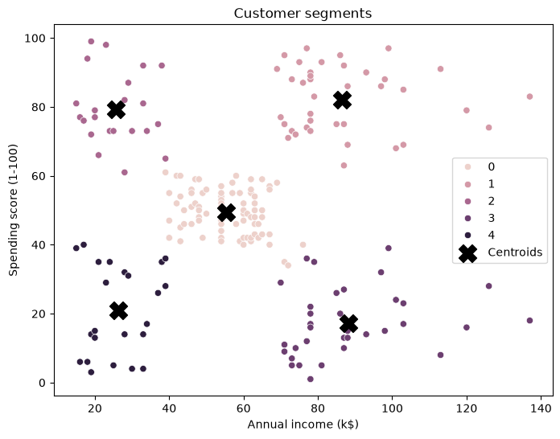
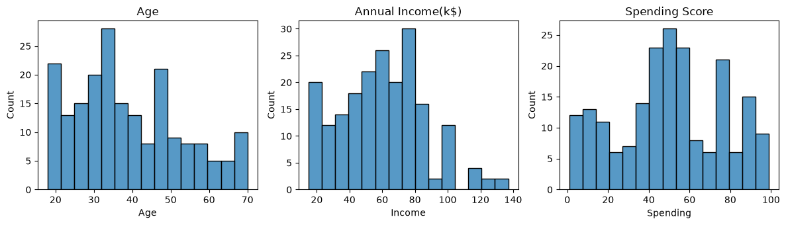
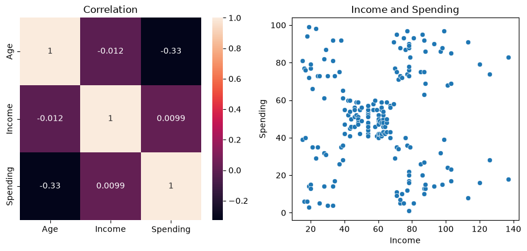
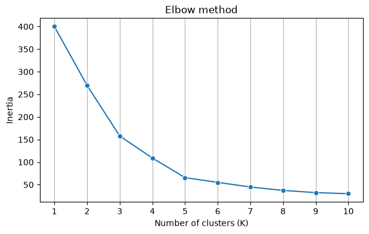
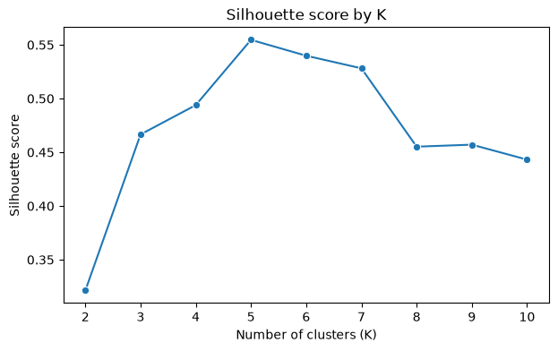

<div align="center">

# 🛍️ Customer Segmentation using K-Means Clustering

**Grouping mall customers by income and spending behaviour, then turning each group into a marketing action**


<br/><br/>



</div>

---

## 📌 Project Overview

This project groups the customers of a shopping mall into segments based on how much they earn and how much they spend. No column in the data says which group a customer belongs to, so this is an **unsupervised learning** problem. I scale the features, choose the number of clusters with the **elbow method** and the **silhouette score**, fit **K-Means**, and describe what each segment looks like.

**Task objective:** group customers by purchasing behaviour and describe each segment.

| Requirement | How it was met |
|---|---|
| Group customers by behaviour | K-Means on annual income and spending score |
| Choose the number of clusters | Elbow method and silhouette score both point to K = 5 |
| Describe each segment | Cluster profiles (average age, income, spending, gender share) and named segments |
| Turn results into actions | One suggested marketing action per segment |

---

## 📊 Dataset

- **Source:** [Mall Customer Segmentation Data](https://www.kaggle.com/datasets/vjchoudhary7/customer-segmentation-tutorial-in-python) on Kaggle
- **Size:** 200 customers with 5 columns: `CustomerID`, `Gender`, `Age`, `Annual Income (k$)`, `Spending Score (1-100)`
- **Quality:** no missing values and no duplicate rows

The raw file is not stored in this repository. Download it and save it as `data/Mall_Customers.csv` (see [`data/README.md`](data/README.md)).

---

## 🔄 Workflow

```
Raw data  →  Checks & cleaning  →  EDA  →  Scaling  →  Choose K  →  K-Means  →  Profiles  →  Actions
```

### 1. Data checks and cleaning

- Confirmed **200 rows** with no missing values and no duplicates
- Dropped `CustomerID` (only a label) and shortened the two long column names to `Income` and `Spending`
- Gender split: 112 female and 88 male customers

### 2. Exploratory data analysis

<div align="center">



</div>

- Most customers are in their 20s, 30s and 40s; income is centred on about 60 thousand dollars; spending scores are spread over the whole range.
- Nothing looked like an error, so no customer was removed.

<div align="center">



</div>

- Income and spending have almost no straight-line relationship (**0.01**), and age and spending are weakly negative (**-0.33**).
- A single line cannot describe these customers, but the scatter plot shows clear clumps, which is exactly what clustering can find.

### 3. Feature scaling

Income and Spending are standardised with `StandardScaler` (mean 0, standard deviation 1), because K-Means works with distances and a column with larger numbers would otherwise count for more. Age and Gender are left out, so the segments are based on spending behaviour. No train/test split is used, because there is no target to predict.

### 4. Choosing the number of clusters

| Elbow method | Silhouette score |
|---|---|
|  |  |

- **Elbow:** inertia falls steeply up to K = 5 (400.0 at K = 1 to 65.6 at K = 5) and then flattens (55.1 at K = 6).
- **Silhouette:** highest at K = 5 (**0.5547**), compared with 0.5399 at K = 6 and 0.4939 at K = 4.
- Both methods agree, so **K = 5** was used.

### 5. Segment profiles

| Segment | Customers | Avg age | Avg income (k$) | Avg spending score | Women |
|---|---|---|---|---|---|
| 🏆 **Premium customers** | 39 | 32.7 | 86.5 | 82.1 | 54% |
| ⚠️ **Careful big earners** | 35 | 41.1 | 88.2 | 17.1 | 46% |
| 🆕 **Young enthusiasts** | 22 | 25.3 | 25.7 | 79.4 | 59% |
| 👥 **Average customers** | 81 | 42.7 | 55.3 | 49.5 | 59% |
| 💤 **Budget savers** | 23 | 45.2 | 26.3 | 20.9 | 61% |

---

## 💡 Suggested Actions

| Segment | Profile | Suggested action |
|---|---|---|
| **Premium customers** | High income, high spending | Keep them loyal with VIP offers and early access to new products |
| **Careful big earners** | High income, low spending | They can afford more but are not buying; test targeted promotions on premium items |
| **Young enthusiasts** | Low income, high spending | Offer trendy products, student deals and loyalty rewards |
| **Average customers** | Middle income, middle spending | The largest group; keep them with regular discounts and seasonal campaigns |
| **Budget savers** | Low income, low spending | Low priority for costly campaigns; reach them with low-cost clearance offers |

---

## 🔍 Key Findings

- **The segments are well separated.** A silhouette score of 0.5547 is above 0.5, so customers sit clearly inside their own cluster.
- **Income alone does not predict spending.** Their correlation is 0.01. Two groups earn a high income, yet one spends heavily and the other barely spends.
- **The biggest opportunity is the 35 careful big earners.** They have the means to spend more, so a small rise in their spending is worth more than the same effort on budget savers.
- **Young customers spend more than their income suggests.** Young enthusiasts have an average age of 25, a low income and a high spending score.
- **Gender does not drive the segments.** The share of women is similar in every group (46% to 61%), while age differs a lot.

> **Note:** the spending score is supplied by the mall, not measured from real purchases, and the dataset is small (200 customers), so the segments may change with a larger sample.

---

## 🚀 How to Run

1. **Clone the repository**
   ```bash
   git clone https://github.com/AreejSimab/customer-segmentation-kmeans.git
   cd customer-segmentation-kmeans
   ```
2. **Install the requirements**
   ```bash
   pip install -r requirements.txt
   ```
3. **Add the dataset:** save `Mall_Customers.csv` in the `data/` folder (see [`data/README.md`](data/README.md)).
4. **Run the analysis:** open `notebooks/customer_segmentation.ipynb` in Jupyter and run all cells, or run the script from the repository root:
   ```bash
   python src/customer_segmentation.py
   ```

---

## 📁 Repository Structure

```
customer-segmentation-kmeans/
├── data/
│   └── README.md                     # Where to download Mall_Customers.csv
├── images/
│   ├── customer_segments.png
│   ├── distributions.png
│   ├── relationships.png
│   ├── elbow_method.png
│   └── silhouette_score.png
├── notebooks/
│   └── customer_segmentation.ipynb   # Full analysis with explanations and outputs
├── src/
│   └── customer_segmentation.py      # The same analysis as a plain script
├── .gitignore
├── LICENSE
├── README.md
└── requirements.txt
```

---

## 🧰 Tools Used

Python • pandas • NumPy • Matplotlib • Seaborn • scikit-learn • Jupyter Notebook

---

## ⚠️ Limitations

- Small dataset (200 customers)
- Only two features form the segments; age and gender only describe them
- K-Means needs the number of clusters chosen in advance and finds round, similar-sized groups

---

## 🔮 Possible Next Steps

- Add age and gender as clustering features and compare the results
- Try hierarchical clustering or DBSCAN as alternatives to K-Means
- Use real purchase data (visit frequency, basket size) instead of a supplied score
- Track the segments over time to see whether customers move between them

---

## 📄 License

The code and documentation in this project are released under the [MIT License](LICENSE). The dataset remains subject to its original terms on Kaggle.

---

## 👩‍💻 Author

**Areej Simab**, BSc (Hons) Computer Science student focused on data science and analytics.

<a href="https://www.linkedin.com/in/areej-simab-3718502a3"></a>
<a href="mailto:areejsimab@gmail.com"></a>
<a href="https://github.com/AreejSimab"></a>

⭐ If you found this project useful, feel free to star the repository.
